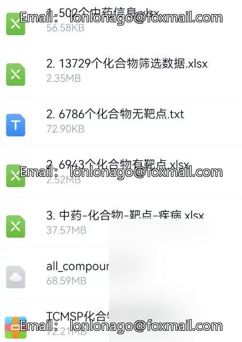

# TCMSP database complete edition 2024.

## Body

TCMSP database complete edition 2024.
Used for network pharmacology analysis and other purposes.

[1] The component includes fine-tuned OB greater than 30% and DL greater than 0.18.
[2] All traditional Chinese medicine data is correlated with its components and corresponding targets.
[3] No manual organization of tcmsp data is needed; everything is accomplished with a single file!

In addition, including files in 4 compound formats of 13,144, files with formats mol2, sdf, pdb, pdbqt (can be used for batch molecular docking).

1. 502 medicinal information.xlsx
2. 6786 compounds without target.txt
3. 6943 compounds with target.xlsx
4. 13729 compounds screening data.xlsx
5. Medicinal compounds-target compounds-target diseases 1.xlsx

web-based shipment, can be directly photographed and shipped.

The TCMSP database 2024 edition is for network pharmacology analysis; it includes components with OB greater than 30% and DL greater than 0.18, all traditional Chinese medicine data mapped to components and targets, along with 13,144 files in four compound formats and multiple Excel and text files, available via a web platform.

<!-- AI_ENRICHED -->

## Images

## Payment

Here is a pay link on Stripe ( https://buy.stripe.com/3cs8yP7sY87d0vu9AB ). Please contact me lonlonago@foxmail.com after funding $89, and I will send you a complete data files , thank you!

